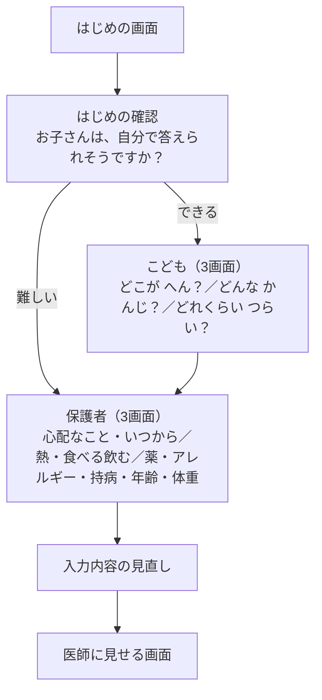
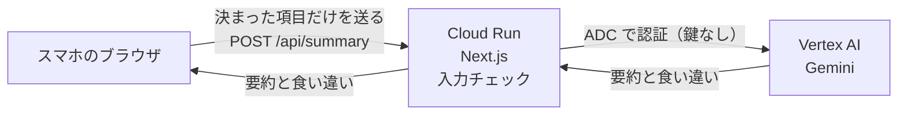

# からだの こえ

子ども向けの受診前の問診アプリです。こどもと保護者の答えを分けて集め、Gemini が医師向けに整理し、食い違いを見つけます。AI は診断しません。

**公開URL：** https://medical-handoff-1003742484355.asia-northeast1.run.app

**チーム：** HINAKAI_AI木曜会（DF-2026-T188）

## 解決したい課題

子どもは症状をことばにしにくく、本人・保護者・医師のあいだで行き違いが起きやすい、という課題です。チームのうち2人に、実際にその経験があります。

## 主な機能

- **こどもと保護者の答えを分ける：** 1台のスマホで、こどもが答えたあとに保護者が答えます。見直し画面からは、こどもの答えを直せません。直すときは、こどもと一緒にこどもの画面に戻ります
- **こどもが答えやすい質問：** 1画面1問で、絵のカードから選びます
- **医師に見せる画面：** AI の要約と食い違いを中心に出します。元の回答は「詳しく見る」で見られます
- **食い違いの表示：** こどもの答えと保護者の答えを並べて出します。どちらが正しいかは示しません
- **薬とアレルギーの表示：** 「ある」のときは ⚠ の行で出します。AI は通しません
- **「不明」の表示：** 必須の項目のうち答えがないものを、AI を使わずルールで出します

## 画面の流れ



## 構成



このアプリは回答を保存しません。データベースも、ブラウザの保存領域（`localStorage` など）も使っていません。

## Gemini の役割

モデルは `gemini-3.8-flash` です。

**すること**

- こどもの答えと保護者の答えを、別々に要約する
- こどもの選択と保護者の答えを、言葉が違っても意味で突き合わせ、食い違いを具体的に出す

**させないこと**

- 診断、病名や原因の推測、助言
- どちらの答えが正しいかの判断
- 入力にないことを推測で埋めること、状態や経過を書き足すこと
- こどもと保護者の答えを混ぜること
- 別々の選択肢を結びつけること
- 打ち間違いを直すこと（直さず「」に入れて、入力どおりに書きます）

**送らないもの**

薬、アレルギー、持病、年齢、体重、身長、性別、名前は Gemini に送りません。

## 安全の考え方

- **保存しない：** 回答を保存しません
- **鍵を持たない：** API キーを使わず、ADC（Application Default Credentials）で Vertex AI を呼びます
- **ログに中身を出さない：** アプリのログに出すのは、成功か失敗か、エラーの種類、かかった秒数、やり直した回数だけです。回答や要約の中身は出しません
- **送ってはいけない項目はサーバーで拒否する：** 決まった項目と値だけを通します。薬などの項目が入っていると、全体を拒否します

サーバーが確かめるのは項目の名前と値の形です。保護者の自由入力の文の中に書かれた内容までは拒否できません。

つなぎ方の詳しい決まりは [docs/api-summary.md](docs/api-summary.md) にあります。

## 使った技術

| 種類 | 名前 | バージョンなど | ライセンス |
|---|---|---|---|
| 実行基盤 | Cloud Run | ビルドパックでデプロイ | |
| AI | Vertex AI の Gemini | `gemini-3.8-flash` | |
| 実行環境 | Node.js | 24.x | |
| フレームワーク | Next.js | 16.4.5 | MIT |
| 画面 | React、React DOM | 19.3.0 | MIT |
| Gemini の呼び出し | `@google/genai` | 2.32.0 | Apache-2.0 |
| 見た目 | Tailwind CSS | 4.3.4 | MIT |
| フォント | Zen Maru Gothic（Google Fonts） | | SIL Open Font License 1.1 |
| 言語 | TypeScript | 5.9.3 | Apache-2.0 |
| コードの検査 | ESLint | 9.39.5 | MIT |
| 自動テスト | Node.js 標準の `node:test` | | |

## 手元での動かし方

Node.js 24 が必要です。

```bash
npm install
```

```bash
gcloud auth application-default login
```

```bash
npm run dev
```

```bash
npm test
```

- 鍵や秘密の値を置く必要はありません。`.env` も使いません
- 要約を作るには、ログインしたアカウントに、Google Cloud のプロジェクト `hinakai` の Vertex AI を使う権限が必要です（`lib/summary/gemini.ts` に書いてあります）。権限がないと要約は作れず、画面には失敗の表示と元の回答が出ます
- `npm test` には、ログインも Gemini も要りません

## 自動テスト

`npm test` で65件が動きます。Gemini は呼びません。データはすべて架空です。

| ファイル | 件数 | 対象 |
|---|---|---|
| `lib/summary/validate.test.ts` | 40 | 入力チェック（送ってはいけない項目の拒否、文字数の上限、体温の形など） |
| `lib/summary/input.test.ts` | 13 | Gemini に送るデータの組み立て |
| `lib/intake/unknowns.test.ts` | 12 | 「不明」の数え方、薬とアレルギーの ⚠ の行 |

受け口（`app/api/summary/route.ts`）、Gemini の呼び出し、画面は、自動テストの対象外です。

## AI の利用

開発に Claude Code を使いました。詳しくは [docs/ai-usage-log.md](docs/ai-usage-log.md) にあります。判断の記録は [docs/decision-log.md](docs/decision-log.md) にあります。

画面のデザイン案とイラストの一部は、チームメンバーが ChatGPT で作成したものを参考・利用しました。

## ライセンス

[MIT License](LICENSE) です。
