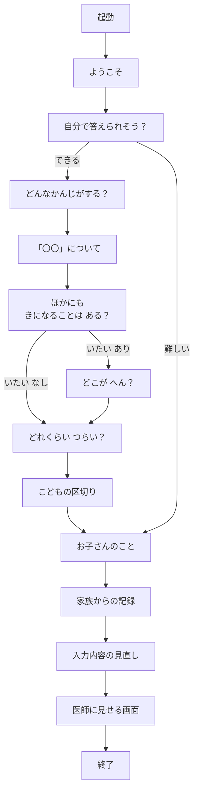
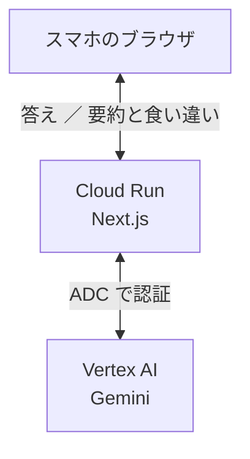

# からだの こえ

子ども向けの受診前の問診アプリです。こどもと保護者の答えを分けて集め、Gemini が医師向けに整理し、食い違いを見つけます。AI は診断しません。

**公開URL：** https://medical-handoff-1003742484355.asia-northeast1.run.app

**チーム：** HINAKAI_AI木曜会（DF-2026-T188）

この説明では、こども（本人）と保護者（家族）の答えを、それぞれ「こどもの答え」「保護者の答え」と書きます。

## 試し方

スマホのブラウザで公開URLを開き、次のとおりに進めます。入力は架空のものでかまいません。答えはどこにも保存しません（画面を閉じると消えます）。

1. 「はじめる」を押し、「お子さんは、自分で答えられそう？」で「できる」を選ぶ
2. 「どんなかんじがする？」で「いたい」を選ぶ
3. 「『いたい』について」で「ズキズキ」を選ぶ
4. 「ほかにも きになることは ある？」で「ない」を選ぶ
5. 「どこが へん？」で「おなか」を選ぶ
6. 「どれくらい つらい？」で「すごく つらい」を選ぶ
7. 「お子さんのこと」は空欄のまま進む。「家族からの記録」で、保護者から見た気になる症状の「熱がある」を選び、その他に「お腹は痛がっていません。元気はあります。」と書く。熱は「38℃以上」を選ぶ
8. 見直しのあと、医師に見せる画面で、「こどもと保護者の答えの食い違い（AIが見つけたもの）」と、薬・アレルギーの行を見る（食い違いの例：こどもは「いたい、お腹」、保護者は「お腹は痛がっていません」。AI の言い回しは毎回少し変わります）

⚠ の行は、家族からの記録で、アレルギーか飲んでいる薬に「ある」を選んだときに出ます。選ばないときは「未確認」と出ます。

## 解決したい課題

子どもは症状をことばにしにくく、本人・保護者・医師のあいだで行き違いが起きやすい、という課題です。チームのうち2人に、実際にその経験があります。

## 主な機能

- **こどもと保護者の答えを分ける：** 1台のスマホで、こどもが答えたあとに保護者が答えます。見直し画面では、こどもの答えを書き換えられません。直すときは「お子さんと一緒に選び直す」で、こどもの画面に戻ります
- **こどもが答えやすい質問：** 1画面1問で、カードから選びます。カードの絵文字には、必ず言葉を添えています。「どれくらい つらい？」は、段階ごとに色の違うキャラクターの顔と言葉の5段階です
- **主な症状と、くわしい答え：** 「どんなかんじがする？」で主な症状を7つ（いたい、きもちわるい、いきがくるしい、せきがでる、かぜっぽい、そのほか、わからない）から選び、選んだものごとに「『〇〇』について」の画面でくわしく答えます（例：「どんなふうに いたい？」ズキズキ・チクチクなど）。最後に「ほかにも きになることは ある？」を聞きます。前に答えたものと同じ意味の選択肢は隠します。文言・選択肢・絵文字は、チームメンバーのデザイン（症状画面）のとおりです
- **部位は「いたい」のときだけ：** 「どこが へん？」は、主な症状で「いたい」を選んだときだけ聞きます
- **保護者は選んで答えるのが中心：** 保護者から見た気になる症状は、選択肢（痛がっている、気持ち悪そう、息が苦しそう、せきが出る、かぜっぽい、熱がある、吐いた・吐き気がある、下痢・便がゆるい、発疹・肌が赤い）から選び、ほかにあれば「その他」に書きます。熱は範囲（38℃以上、37〜38℃未満、36〜37℃未満、36℃未満）か「測っていない」を選び、分かれば数字も入れます。選択肢のボタンは縦一列に並べます（性別だけ横一列）
- **くわしい答えは医師の画面に出すだけ：** くわしい答えと「ほかに きになること」の答えは Gemini に送らず、見直しと医師の画面（詳しく見る）に言葉で出すだけです
- **進み具合と戻り方：** 上の進み具合のバーと、左上の「もどる」で示します。ブラウザの「戻る」でも同じ画面に戻ります（バーの区切りは下の「画面の流れ」を参照）
- **キャラクターの案内：** 画面の上の案内は、選んだ内容に応じて決まった文を出すだけです。AI は使いません
- **医師に見せる画面：** AI の要約と食い違いを中心に出します。元の答えは「詳しく見る」で見られます
- **食い違いの表示：** 「こどもと保護者の答えの食い違い」という見出しで、こどもの答えと保護者の答えを並べて出します。どちらが正しいかは示しません
- **薬とアレルギーの表示：** 「ある」のときは ⚠ の行で出します。AI は通しません
- **「不明」の表示：** 必須の項目のうち答えがないものを、AI を使わずルールで出します

## 画面の流れ



- **起動：** 約1.5秒で、押すと飛ばせます
- **どんなかんじがする？：** 主な症状を7つから選びます（複数選べます）
- **「〇〇」について：** 選んだ主な症状ごとに1画面ずつ出ます（いたい、きもちわるい、いきがくるしい、せきがでる、かぜっぽい の順）。そのあと、必ず「ほかにも きになることは ある？」が出ます
- **どこが へん？：** 主な症状で「いたい」を選んだときだけ出ます
- **お子さんのこと：** 年齢・性別・体重（すべて任意）
- **家族からの記録：** 保護者から見た気になる症状・いつから・熱・食べる飲む・持病・アレルギー・薬を1ページで聞きます
- **「難しい」のとき：** こどもの画面と区切りを飛ばします
- **見直し画面：** 保護者の項目だけを「編集」で直せます
- **進み具合のバー：** 7区切りです（自分で答えられそう？／どんなかんじがする？／くわしい答えとどこが へん？／どれくらい つらい？／お子さんのこと／家族からの記録／入力内容の見直し）。「難しい」のときは、こどもの3区切りを飛ばして4区切りです。くわしい答えの区切りは、中の画面を進んだ分だけ埋まります。起動、ようこそ、こどもの区切り、医師に見せる画面、終了の画面には、バーを出しません

## 構成



- 画面は、決まった項目だけを `POST /api/summary` に送ります
- サーバー（Cloud Run の Next.js）が項目を確かめてから、Gemini を呼びます。鍵（API キー）は使わず、ADC で認証します
- このアプリは答えを保存しません。データベースも、ブラウザの保存領域（`localStorage` など）も使っていません

## Gemini の役割

モデルは `gemini-3.8-flash` です。

**すること**

- こどもの答えと保護者の答えを、別々に要約する
- こどもの選択と保護者の答えを、言葉が違っても意味で突き合わせ、食い違いを具体的に出す

**させないこと**

- 診断、病名や原因の推測、助言
- どちらの答えが正しいかの判断
- 入力にないことを推測で埋めること、状態や経過を書き足すこと
- こどもと保護者の答えを混ぜること
- 別々の選択肢を結びつけること
- 打ち間違いを直すこと（直さず「」に入れて、入力どおりに書きます）

**送るもの（こども）**

主な症状のうち、いたい・きもちわるい・いきがくるしい・せきがでる、部位（「いたい」のとき）、つらさの段階だけを送ります。かぜっぽい・そのほか・わからない は送りません。

**送るもの（保護者）**

保護者から見た気になる症状、いつから、熱、食べる・飲む だけを送ります。

- 気になる症状は、選んだ選択肢と「その他」に書いた文を1つの文にまとめて送ります（例：「気になる症状：熱がある。その他：お腹は痛がっていません。元気はあります。」）。まとめた文で500文字までです
- 熱は、数字か「測っていない」だけを送ります。範囲（38℃以上など）は送らず、医師の画面に出すだけです

**送らないもの**

薬、アレルギー、持病、年齢、体重、性別、名前、熱の範囲は Gemini に送りません。こどものくわしい答え（ズキズキなど）と「ほかに きになること」の答えも送りません（医師の画面に出すだけです）。

## 安全の考え方

- **保存しない：** 答えを保存しません
- **鍵を持たない：** API キーを使わず、ADC（Application Default Credentials）で Vertex AI を呼びます
- **ログに中身を出さない：** アプリのログに出すのは、成功か失敗か、エラーの種類、かかった秒数、やり直した回数だけです。答えや要約の中身は出しません
- **送ってはいけない項目はサーバーで拒否する：** 決まった項目と値だけを通します。薬などの項目が入っていると、全体を拒否します

サーバーが確かめるのは項目の名前と値の形です。保護者の自由入力の文の中に書かれた内容までは拒否できません。

つなぎ方の詳しい決まりは [docs/api-summary.md](docs/api-summary.md) にあります。

## 使った技術

| 種類 | 名前 | バージョンなど | ライセンス |
|---|---|---|---|
| 実行基盤 | Cloud Run | ビルドパックでデプロイ | |
| AI | Vertex AI の Gemini | `gemini-3.8-flash` | |
| 実行環境 | Node.js | 24.x | |
| フレームワーク | Next.js | 16.4.5 | MIT |
| 画面 | React、React DOM | 19.3.0 | MIT |
| Gemini の呼び出し | `@google/genai` | 2.32.0 | Apache-2.0 |
| 見た目 | Tailwind CSS | 4.3.4 | MIT |
| フォント | Zen Maru Gothic、Plus Jakarta Sans（Google Fonts。`next/font` でアプリに組み込む） | | SIL Open Font License 1.1 |
| 言語 | TypeScript | 5.9.3 | Apache-2.0 |
| コードの検査 | ESLint | 9.39.5 | MIT |
| 自動テスト | Node.js 標準の `node:test` | | |

## 手元での動かし方

Node.js 24 が必要です。

```bash
npm install
```

```bash
gcloud auth application-default login
```

```bash
npm run dev
```

```bash
npm test
```

- 鍵や秘密の値を置く必要はありません。`.env` も使いません
- 要約を作るには、ログインしたアカウントに、Google Cloud のプロジェクト `hinakai` の Vertex AI を使う権限が必要です（`lib/summary/gemini.ts` に書いてあります）。権限がないと要約は作れず、画面には失敗の表示と元の答えが出ます
- `npm test` には、ログインも Gemini も要りません

## 自動テスト

`npm test` で137件が動きます。Gemini は呼びません。データはすべて架空です。

| ファイル | 件数 | 対象 |
|---|---|---|
| `lib/intake/concern.test.ts` | 13 | 保護者から見た気になる症状のまとめ方と500文字の上限、熱の範囲を Gemini に送らないこと |
| `lib/summary/validate.test.ts` | 40 | 入力チェック（送ってはいけない項目の拒否、文字数の上限、体温の形など） |
| `lib/summary/input.test.ts` | 14 | Gemini に送るデータの組み立て（性別と身長を送らないことを含む） |
| `lib/intake/unknowns.test.ts` | 19 | 「不明」の数え方、薬とアレルギーの ⚠ の行、見直しと医師の画面の行（こどものくわしい答えを含む） |
| `lib/intake/options.test.ts` | 8 | 部位の言葉と絵、部位の色の読みやすさ（4.5:1 以上）、画面で選べる値が入力チェックを通ること |
| `lib/intake/flow.test.ts` | 13 | 画面の順番（「いたい」のときだけ部位を聞くことを含む）と、進み具合のバーの区切り |
| `lib/intake/guide.test.ts` | 13 | キャラクターの案内の決まった文と表情 |
| `lib/intake/symptoms.test.ts` | 17 | 主な症状とくわしい答えの表と決まり（画面の順番、選び方と消し方、同じ意味を隠す、候補の並び、Gemini に送る主な症状） |

受け口（`app/api/summary/route.ts`）、Gemini の呼び出し、画面は、自動テストの対象外です。

## AI の利用

アプリの中で使う AI は Gemini だけです。

開発に Claude Code を使いました。詳しくは [docs/ai-usage-log.md](docs/ai-usage-log.md) にあります。判断の記録は [docs/decision-log.md](docs/decision-log.md) にあります。

画面のデザインの参考とキャラクターの画像は、チームメンバーが ChatGPT と Codex で作成したものを参考・利用しました。画面デザインの参考には、Google Antigravity と Google Stitch も使いました。つらさの5段階の色付きの顔は、チームメンバーが画像生成 AI で作りました（ツール名は確認中）。キャラクターの元の画像（PNG）には、OpenAI で作成した記録が埋め込まれていました（`public/mascot/` の画像は、縮めたときにこの記録が外れています）。

## ライセンス

[MIT License](LICENSE) です。
